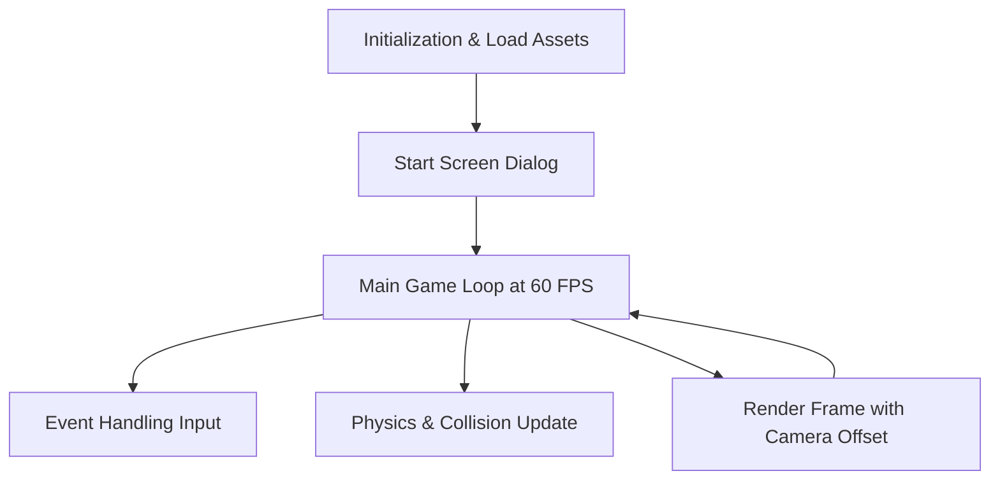

# Donkey Kong V2 - Game Design Document

## 1. System Architecture

This game is a standalone 2D side-scrolling platformer built in Python using the `pygame` library. The architecture relies on a standard **Game Loop Model**.

## 2. Core Modules

The codebase will be modularized into the following components:

### 2.1 Settings (`settings.py`)
Centralized configuration for the game:
- **Screen Dimensions**: Window size of 1280x528 (using 16x16 tiles). The game *world* will be much wider (e.g., 3200x528) to allow for side-scrolling.
- **Physics Values**: Gravity strength, jump velocity, movement speed.
- **Colors**: RGB definitions for text and backgrounds.
- **FPS**: 60.
- **Game Constants**: Max levels (10), Coins required for 1-Up (50).

### 2.2 Level Generation (`level_generator.py`)
Since this is a brand new game, levels are generated procedurally using a robust algorithmic factory. It will output a 2D matrix (a grid) of the map layout. 
- It will place solid floors with randomized gaps.
- It will place 2-3 ladders per floor, guaranteeing a path on the far left and right edges.
- It will scatter collectable coins.

### 2.3 UI / HUD (Heads-Up Display)
We will implement a clean, retro-style UI overlay using `pygame.font`.
- **Start Screen**: Before the game begins, a dialog box will appear displaying the backstory ("The Queen has been captured by the Donkey!") and instructions for the controls. The player must press a key to start.
- **Placement**: The top-left corner will display `SCORE: 000` and `LEVEL: 1/10`. The top-right corner will display `LIVES: ♥ ♥ ♥` and `COINS: 0/50`.
- **Rendering**: The text will be rendered on top of the game board every frame so it is always visible.

### 2.4 Sprites (`sprites.py`)
All physical entities in the game will inherit from `pygame.sprite.Sprite`.
- **Static Sprites**: `Platform`, `Ladder`, `Coin`, `Portal` (Levels 1-9), `Queen` (Level 10). These have fixed positions. 
- **Dynamic Sprites**: 
  - `Player`: Will handle sub-pixel position tracking, applying vertical velocity (gravity), jumping state, animation frames, and checking collisions against `Platform` and `Ladder` groups.
  - `Donkey`: Will contain state logic to pace left and right on its designated platform and spawn `Fireball` sprites on a timer.
  - `Fireball`: Will inherit gravity physics and bounce logic when colliding with platforms.

### 2.5 Game Progression & Mechanics
- **10-Level System**: The game features 10 levels. 
- **The Portal**: In Levels 1-9, there is no Queen. Instead, a `Portal` spawns at a random location on the top half of the board (placed in the air, not strictly on a floor, requiring clever jumping/climbing to reach). Reaching the Portal advances the player to the next level.
- **The Queen**: In Level 10, the Portal is replaced by the Queen in the top cage. Rescuing her beats the game.
- **1-Up Mechanic**: Collecting a threshold of coins (50 coins) automatically grants the player +1 Life. The coin counter then resets to 0.

### 2.6 Side-Scrolling & Boss Bypass Strategy
- **Wider Floors**: The levels are wider than the screen (e.g., 200 tiles wide). The Pygame Engine will use a **Camera** to track the player, scrolling the screen left and right.
- **Multiple Ladders**: The map generation will ensure at least 2 or 3 stairs spawn per floor (e.g., one on the far left, one on the far right).
- **Boss Bypass**: The Donkey's patrol path is restricted to the center of his platform. By utilizing the far-left or far-right ladders, the player can safely bypass the Donkey without having to run directly through him.

## 3. Pixel Art Integration

The game will utilize pixel art sprites. 
- All sprites will be authored as 16x16 or 32x32 PNGs.
- `main_pygame.py` will load these assets into memory.
- `pygame.transform.flip()` will be used to flip the Player sprite when changing horizontal direction.
- `image.set_colorkey()` will be used to remove any solid background colors from the sprites (like neon green) to make them properly transparent.

## 4. Collision Detection Strategy

Collision will rely on Pygame's `Rect` collision (`sprite.rect.colliderect(other.rect)`).
- **Horizontal Collision**: Applied first. If the Player hits a Platform while moving left/right, their position is snapped to the edge of the Platform.
- **Vertical Collision**: Applied second. If the Player is falling and hits a Platform, vertical velocity is set to 0, and the jumping state is reset.

## 5. Deployment Strategy (Itch.io)

Once the game is fully developed, it will be packaged for distribution on Itch.io using two distinct methods:
1. **Web Browser (HTML5)**: We will utilize `pygbag` to compile the Pygame Python code into WebAssembly (WASM). This allows players to play the game instantly inside their web browsers on the Itch.io page without downloading anything.
2. **Standalone Executable**: For players who prefer offline play, we will use `PyInstaller` to bundle the Python interpreter, the Pygame library, and all `assets/` into a single standalone Windows `.exe` file.
